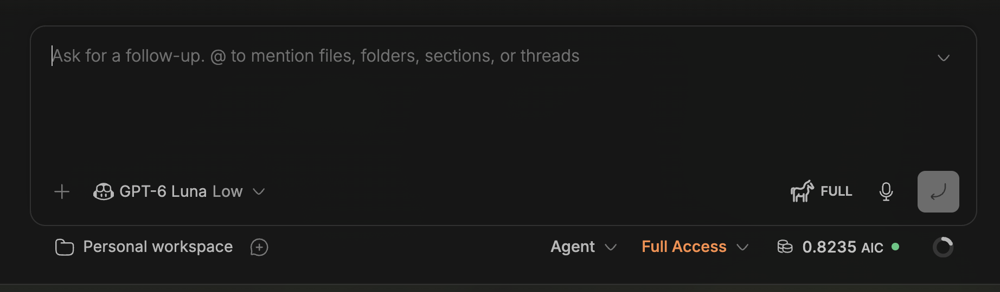
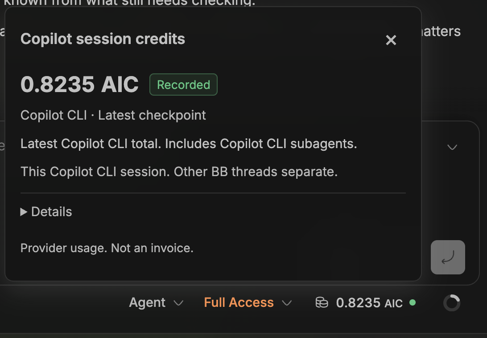
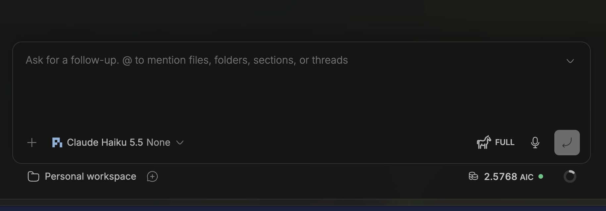

# Copilot session credits

GitHub Copilot AI Credits for the current BB thread, beside the context indicator. Click the indicator to see usage or set up Pi capture.

## In use

**Copilot CLI** — session credits beside the context indicator. No companion installation required.



Click the amount for the latest checkpoint and session scope.



**Pi with GitHub Copilot** — credits captured by the Pi companion. Pi coverage is partial; earlier calls and hidden retries may be missing.



Screenshots from live user QA. Amounts shown belong to those sessions, not a remaining subscription balance.

## Install

Requires **BB 0.48.1+** and authenticated GitHub Copilot access. Tested on macOS.

Install **Copilot session credits** from BB Community when available, or from Git:

```sh
bb plugin install git:https://github.com/lalitjeevanrao/copilot-session-credits.git@v0.2.2 --plugin session-credits
```

**Copilot CLI:** no extra installation. Credits appear when the CLI reports usage.

**Pi Coding Agent:** requires Pi **1.5.0+**. On the machine running Pi:

```sh
pi install git:https://github.com/lalitjeevanrao/copilot-session-credits.git@v0.2.2
```

Use the same Pi executable and agent directory as BB. For remote threads, install on the remote host. Match any `PI_CODING_AGENT_DIR` or custom launcher configuration.

Start a new session after installation. For an existing thread, stop its runtime with `bb thread stop <thread-id>`, then send your next message to resume it. **Retry check** refreshes the status; it does not restart Pi.

The companion collects usage for BB. It adds no meter to Pi’s TUI.

## What the numbers mean

The indicator shows credits **reported for this session**, not your remaining subscription balance or invoice total. Pi coverage is partial: earlier calls and hidden retries may be missing. A dash means unknown, not zero.

Click the indicator for the exact amount, coverage and capture status. Recorded credits remain visible if capture later stops. **Ready — awaiting Copilot usage** means the Pi extension loaded, but has not recorded usage yet. **Capture unconfirmed** means BB cannot confirm capture; it does not necessarily mean the extension is missing.

## Privacy

The plugin adds no analytics endpoint. Pi receipts store usage amounts, model labels, timestamps and pseudonymous identifiers—not prompts, responses or credentials. They live in private directories under `~/.pi/agent/session-credits/`; startup status lives in `~/.pi/agent/session-credits-status/`.

Copilot CLI usage is read from a bounded local log tail. Only usage fields are returned to BB. [Security details](SECURITY.md) · [Accounting and coverage](docs/accounting.md).

## Update or remove

Git-tag installs are pinned. To replace an older BB release:

```sh
bb plugin remove session-credits
bb plugin install git:https://github.com/lalitjeevanrao/copilot-session-credits.git@v0.2.2 --plugin session-credits
```

Refresh the BB window after updating. **The v0.2.2 fixes affect the BB UI only; the Pi companion from v0.2.1 can stay installed.** No Pi restart is needed for this UI update.

For a future companion update, use `pi list` to find the installed source, remove that exact source with `pi remove`, then install the newer tag and restart existing Pi sessions.

To uninstall the BB display, run `bb plugin remove session-credits`. To uninstall the companion, run `pi remove` with its installed Git source. Removing either package preserves receipts. The receipt folder has a 256-entry limit; [archive old receipts with Pi stopped](docs/cleanup.md).

## Development

Requires Node 22.19+, BB and Pi 1.5.0+:

```sh
npm --prefix packages/bb-plugin-session-credits ci
npm test
bb plugin install . --plugin session-credits
```

Tests use synthetic transport and make no paid model calls. Composer placement follows BB’s DOM and may need adjustment after BB UI changes.

[Changelog](CHANGELOG.md) · [Release checklist](docs/releasing.md) · [MIT license](LICENSE)

Author: **Lalit Rao**
