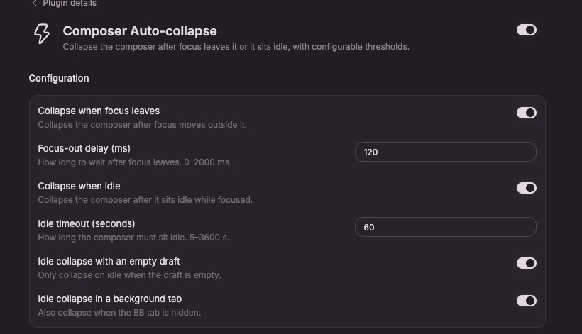

# Composer Auto-collapse

Collapses BB's prompt box when you click outside it or leave it idle, and keeps your draft exactly as it was.



## Install

Requires **BB 0.49.0+**. Tested on macOS.

```sh
bb plugin install git:https://github.com/lalitjeevanrao/bb-plugins.git@composer-autocollapse/v0.1.0 --plugin composer-autocollapse
```

From a clone: `bb plugin install .` inside this directory.

## Behaviour

- **Focus-out** — leaving the composer collapses it after a short delay. Clicks inside the editor, its toolbar, the model picker or a typeahead/portal menu never trigger it.
- **Idle** — after the configured idle time the composer collapses only while focus is still inside it, and only when your draft is empty or the tab is hidden. A visible draft is preserved.
- **Draft safety** — collapsing uses BB's own collapse control, so the draft stays in the editor and re-expanding is the native interaction.
- **Cleanup** — disabling or reloading the plugin removes every listener and timer; mounting twice keeps a single instance.


## Settings

| Setting | Default | Range | Meaning |
| --- | --- | --- | --- |
| Collapse on focus-out | on | — | Collapse when focus leaves the composer |
| Focus-out delay | 120 ms | 0–2000 | Grace period before collapsing |
| Collapse when idle | on | — | Collapse after the idle time |
| Idle time | 60 s | 5–3600 | Idle threshold |
| Only with an empty draft | on | — | Leave a non-empty draft expanded |
| Also when the tab is hidden | on | — | Allow collapse while the tab is in the background |

Changes apply to the open page without a reload; the plugin polls its own settings every 30 seconds.

## Privacy

The plugin has no network calls beyond BB's own plugin RPC. It reads focus, visibility and the draft's text length inside the page and stores only the six settings above. No prompts, drafts or usage data leave the page.

## Compatibility and limits

BB 0.49.0+ (plugin SDK 0.6.132+). Visibility follows rendered layout, so a CSS-hidden desktop/compact composer is skipped rather than collapsed by mistake. If BB changes its composer markup, the plugin does nothing and leaves the page usable.

## Development

```sh
npm ci
npm test          # policy, visibility and jsdom lifecycle tests
npm run typecheck
npm run build
```

Author: **Lalit Rao** · [MIT license](../../LICENSE)
