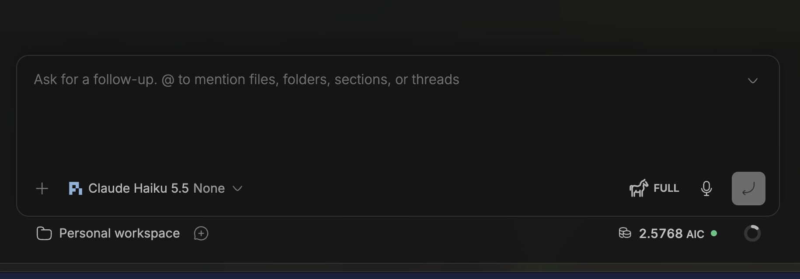

# Copilot session credits

GitHub Copilot AI Credits for the current BB thread, beside the context indicator. Click the indicator to see usage or set up Pi capture.




Screenshots from live user QA. Amounts shown belong to those sessions, not a remaining subscription balance.

## Install

Requires **BB 0.48.1+** and authenticated GitHub Copilot access. Tested on macOS.

Install **Copilot session credits** from BB Community when available, or from Git:

```sh
bb plugin install git:https://github.com/lalitjeevanrao/bb-plugins.git@v0.3.2 --plugin copilot-session-credits
```

**Copilot CLI:** no extra installation. Credits appear when the CLI reports usage. Click the amount for the latest checkpoint and session scope.

Supported Copilot ACP IDs are `acp-copilot`, `acp-gh-copilot`, `acp-github-copilot-cli` (official registry), `acp-copilot-quiet` and `acp-copilot-fm`. Other ACP IDs are not accepted by family or prefix. No duplicate manual registration is needed for the official registry provider.

**Pi Coding Agent:** requires Pi **1.5.0+**. On the machine running Pi:

```sh
pi install git:https://github.com/lalitjeevanrao/bb-plugins.git@v0.3.2
```

Use the same Pi executable and agent directory as BB. For remote threads, install on the remote host. Match any `PI_CODING_AGENT_DIR` or custom launcher configuration.

Start a new session after installation. For an existing thread, stop its runtime with `bb thread stop <thread-id>`, then send your next message to resume it. Status refreshes automatically while BB is visible; it does not restart Pi.

The companion collects usage for BB. It adds no meter to Pi's TUI.

## What the numbers mean

The indicator shows credits **reported for this session**, not your remaining subscription balance or invoice total. Pi coverage is partial: earlier calls and hidden retries may be missing. A dash means unknown, not zero.

Click the indicator for the exact amount, coverage and capture status. Recorded credits remain visible if capture later stops. **Ready — awaiting Copilot usage** means the Pi extension loaded, but has not recorded usage yet. If a Pi amount is already recorded, the toolbar keeps **Recorded** even when the current collector cannot be found; its status and reason appear under Details.

## Privacy

The plugin adds no analytics endpoint. Pi receipts store usage amounts, model labels, timestamps and pseudonymous identifiers—not prompts, responses or credentials. They live in private directories under `~/.pi/agent/copilot-session-credits/`; startup status lives in `~/.pi/agent/copilot-session-credits-status/`.

Copilot CLI usage is read from a bounded local log tail. Only usage fields are returned to BB. [Security details](../../SECURITY.md) · [Accounting and coverage](../../docs/accounting.md).

## Update from 0.2.x or remove

Version 0.3.0 changes the BB plugin ID to `copilot-session-credits`. Remove the old BB ID before installing the renamed plugin so both displays do not load:

```sh
bb plugin remove session-credits
bb plugin install git:https://github.com/lalitjeevanrao/bb-plugins.git@v0.3.2 --plugin copilot-session-credits
```

Refresh BB after updating. To replace a later pinned release, remove `copilot-session-credits` before installing the newer source.

**Update the Pi companion too.** Use `pi list` with the same runtime and agent directory as BB, remove the exact currently installed source with `pi remove`, then install the v0.3.2 source shown above. Do not add a second Pi source alongside the old one. Stop/restart existing Pi sessions after the update. The repository URL is unchanged by the collection rename: old `copilot-session-credits` links redirect to `bb-plugins`.

New receipt writes use `~/.pi/agent/copilot-session-credits/`; startup status uses `~/.pi/agent/copilot-session-credits-status/`. The BB reader also reads the legacy `~/.pi/agent/session-credits/` and `~/.pi/agent/session-credits-status/` as compatibility inputs. Existing data remains visible without moving or copying it. Both status roots are checked together: multiple live instances are unconfirmed rather than silently selecting one. No update or removal command deletes or moves receipts.

Uninstall the display with `bb plugin remove copilot-session-credits`. Remove the companion using its exact installed source from `pi list`. [Cleanup guidance covers both new and legacy roots](../../docs/cleanup.md).

## Development

Requires Node 22.19+, BB and Pi 1.5.0+:

```sh
npm --prefix packages/bb-plugin-copilot-session-credits ci
npm test
bb plugin install . --plugin copilot-session-credits
```

Tests use synthetic transport and make no paid model calls. Composer placement follows BB's DOM and may need adjustment after BB UI changes.

This directory contains the BB plugin and shared collector. The repository root supplies the Pi package entrypoint. Copilot CLI needs only the BB plugin; Pi requires the companion and Pi 1.5.0+.

From the repository root, run `npm test`. [Architecture](docs/architecture.md) · [Receipt contract](docs/receipt-contract.md) · [MIT](../../LICENSE)

## Upgrading from the former BB ID

Version 0.3.0 changes the machine ID to `copilot-session-credits`. Remove the old BB ID with `bb plugin remove session-credits`, then install the new ID. Use `pi list` and remove the exact old companion source before installing the current version; restart existing Pi sessions. Never keep two companion installs active. The reader preserves access to legacy `~/.pi/agent/session-credits/` receipts and `~/.pi/agent/session-credits-status/` status alongside the new roots. No files are moved or deleted.
