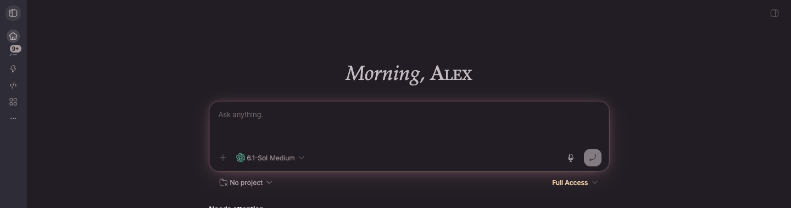
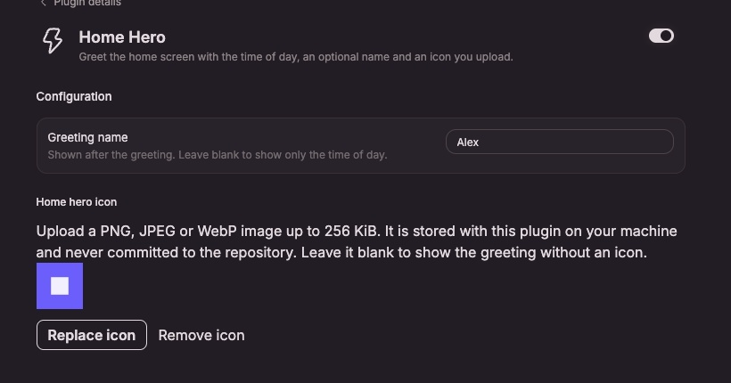

# Home Hero

A time-of-day greeting at the top of BB's home screen, with an optional name and an optional icon you upload.



The greeting keeps the original Palatino italic / Georgia small-caps typography and reads the local time: **Morning**, **Afternoon** or **Evening**. With a name saved it becomes **Afternoon, Alex**.

## Install

Requires **BB 0.49.0+**. Tested on macOS.

```sh
bb plugin install git:https://github.com/lalitjeevanrao/bb-plugins.git@home-hero/v0.1.0 --plugin home-hero
```

From a clone: `bb plugin install .` inside this directory.

## Settings

**Greeting name** — up to 80 characters, trimmed. Leave it blank to show the time of day only; no stray comma appears.

**Icon** — optional. Pick a PNG, JPEG or WebP up to 256 KiB. The browser decodes it, the plugin server checks the real file structure and its declared type, then stores it in this plugin's private BB storage. A file that fails validation leaves the previous icon in place. **Remove** returns to a text-only greeting.



## Privacy

The icon never enters the repository and is never uploaded anywhere: it lives in BB's plugin data directory (`plugins/home-hero/data.db`) on this machine. The plugin has no network calls and collects no usage data. Uploaded images are checked by content, not only by file extension.

## Compatibility and limits

- The hero is placed at the top of BB's home composer column. If BB changes that layout, the plugin leaves the page usable and logs nothing visible; the greeting simply does not appear until the selector is updated.
- Greeting wording is English, 24-hour clock local time.
- The host-rendered "Home hero" section heading is hidden with scoped CSS while the plugin is enabled; there is no page-wide styling.

## Development

```sh
npm ci
npm test          # appearance, greeting, lifecycle and server tests
npm run typecheck
npm run build
```

Tests cover icon validation (header-only, truncated and disguised files), name limits, text-only rendering and single-owner cleanup.

Author: **Lalit Rao** · [MIT license](../../LICENSE)
