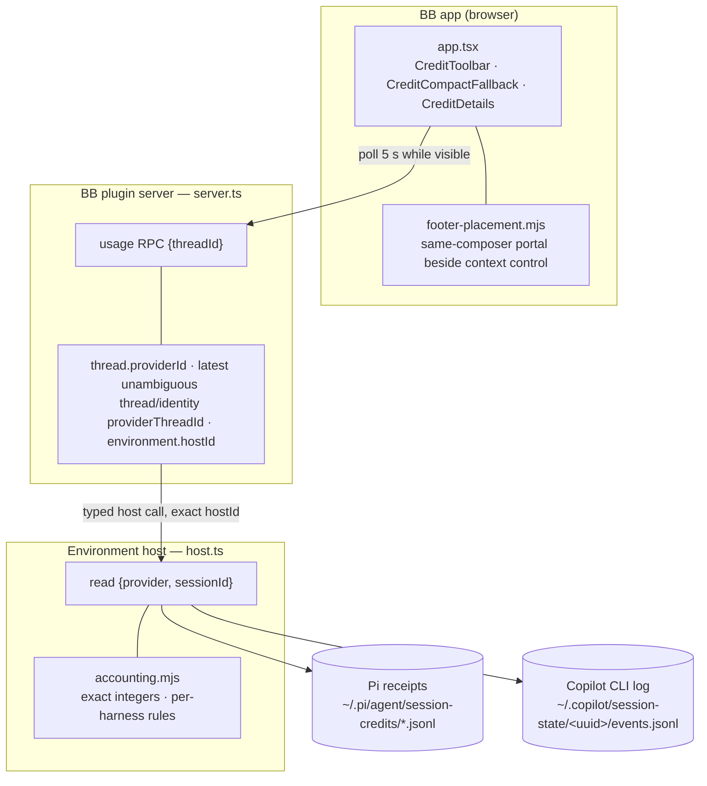

# Architecture

## Components

| Layer | Does | Does **not** |
| --- | --- | --- |
| `app.tsx` | Renders one control per composer layout; opens a nonmodal Radix Popover anchored to that control | Compute credits, read files |
| `server.ts` | Resolves *this thread's* provider, session identity and host | Read prompts, assistant text or tool output |
| `host.ts` | Reads scalar receipts / latest checkpoint on the right machine, with limits | Send transcripts, follow symlinks, delete anything |
| `accounting.mjs` | Exact `BigInt` nano-AIU → AIC; Pi subtotal; CLI checkpoint; meter state | Estimate, convert tokens, sum checkpoints |

## Identity routing

1. The frontend sends only `{ threadId }`.
2. The server loads the thread (`providerId`, environment host). Unsupported providers return *Unavailable* without touching any host.
3. It lists the **two most recent `thread/identity` events**, takes the latest unambiguous `providerThreadId`, validates it as a UUID (optionally `pi_`-prefixed), and calls the **environment's own host**.
4. The host matches that exact session: Pi receipts whose `providerSession` equals it; or the CLI directory named by it.

Pi session IDs in BB (`pi_<uuid>`), native Pi session UUIDs and GitHub request IDs are different identities and are never mixed.

## Pi path

The internal collector (`collector/probe.mjs`) wraps the native GitHub Copilot provider (`stream` and `streamSimple`), observes the raw scalar `copilot_usage.total_nano_aiu` before Pi's normalisation drops it, and writes scalar-only schema-3 receipts. BB reads them via [receipt-contract.md](receipt-contract.md).

The repository root declares a normal Pi package whose entry is `collector/extension.ts`. Users install it with Pi on the execution host. BB installs only its reader/UI package; no env contribution, artifact staging or BB launcher change is used. The companion activates when BB thread metadata is present and requires the actual loaded Pi runtime to be 1.5.0+.

The initializer registers a small startup-readiness reporter. Private `session-credits-status/pi_UUID/instance_UUID.json` files contain only the provider session, process ID, instance ID, runtime version and readiness enum. Each instance owns its file and removes only that file on shutdown. The host validates ownership, modes, bounds and identity, checks process liveness, and treats ambiguous or unsafe records as unconfirmed. Readiness reads bypass the short usage cache. There is no heartbeat; PID reuse and same-user modification are outside this telemetry guarantee.

No receipt is required to show startup readiness. Absence of readiness does not prove an absent installation. Capture errors, unsupported runtimes and on/off commands update the readiness state. Existing usage and accounting health take precedence over “awaiting first usage.” The popup remains actionable before the provider session has started.

## Copilot CLI path

BB already runs the CLI via `acp-copilot` / `acp-gh-copilot`. The host reader opens that session's `events.jsonl`, reads a bounded tail, and keeps the **latest complete `session.usage_checkpoint`**: amount `data.totalNanoAiu`, coverage `data.accountingSnapshot.aiCreditsStatus`. Cumulative: used once.

## Accounting rules

See [accounting.md](accounting.md).

The detail panel uses BB’s shared Radix Popover runtime. Its portal escapes composer overflow while staying anchored above the clicked control. It has no backdrop or modal focus trap. Escape, outside interaction and the close control dismiss it; keyboard dismissal returns focus to the trigger. The panel shares the control’s usage state and polling hook. Mouse-down events stop at the panel boundary so React portal bubbling cannot make the composer steal focus before a native disclosure click. Default browser behavior is preserved.

## Why a DOM adapter

BB SDK `0.6.104` exposes composer actions/banners/popups but no footer slot. The adapter starts at a hidden origin inside the composer customization and scopes to its own `[data-app-composer]`. It places credits before the context control when present, or at the end of the same footer action group before context usage is available. Setup and recorded usage therefore share a location.

A scoped `MutationObserver` handles replacement, absence and ambiguity; cleanup removes only the plugin’s own span. Unsupported or ambiguous markup falls back to the toolbar or compact banner rather than attaching to another composer. This private DOM integration may need adjustment after BB layout changes.
